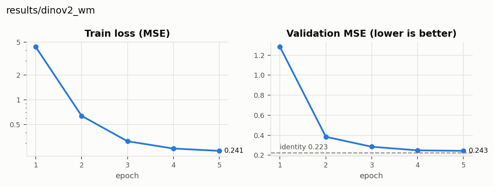

# results/dinov2_wm

residual=False, use_action=True, epochs=5, depth=4, dim=384

## Feature-space error (final epoch, validation)

| Model | val MSE | val cos |
|---|---|---|
| Identity WM | 0.223 | 0.984 |
| results/dinov2_wm | 0.243 | 0.983 |

## Linear probes (held-out R²_joint)

| Model | predictor | displacement | change |
|---|---|---|---|
| Identity WM | 0.907 | 0.391 | -0.000 |
| results/dinov2_wm | 0.923 | 0.839 | 0.772 |

