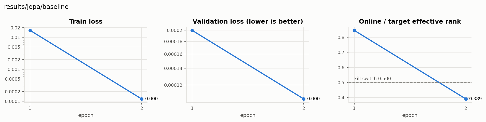

# results/jepa/baseline

encoder=small_vit, projector=False, beta=0.0, momentum=0.996, use_action=True, epochs=5

**COLLAPSE** — rank ratio 0.389 fell below 0.5 at epoch 2; training stopped.

## Linear probes (held-out R²_joint)

| Model | encoder | predictor | displacement | change |
|---|---|---|---|---|
| results/jepa/baseline | 0.382 | 0.245 | 0.876 | 0.864 |

## Training

| Epoch | train loss | invariance | variance | covariance | val loss | rank ratio |
|---|---|---|---|---|---|---|
| epoch 1 | 0.017 | 0.001 | 0.953 | 0.001 | 0.000 | 0.847 |
| epoch 2 | 0.000 | 0.000 | 0.893 | 0.055 | 0.000 | 0.389 |

